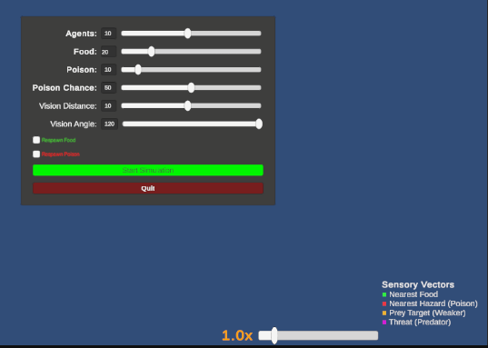
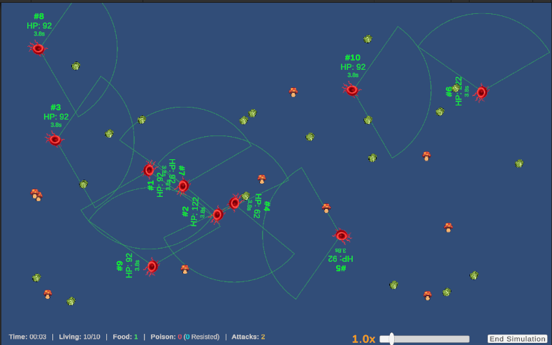
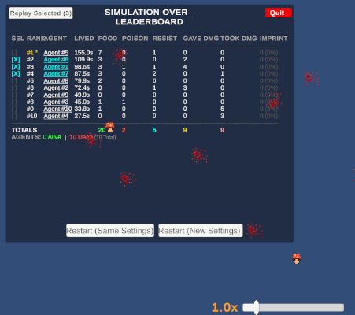
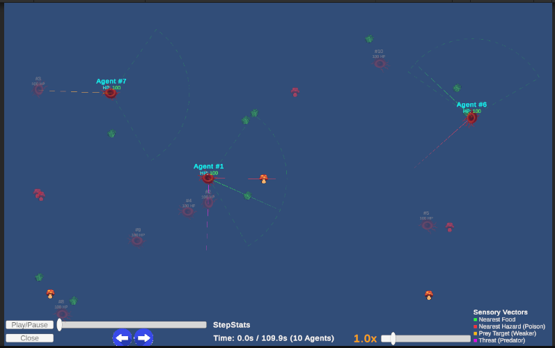
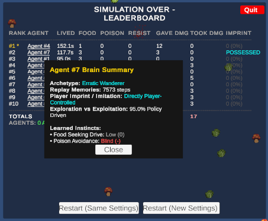
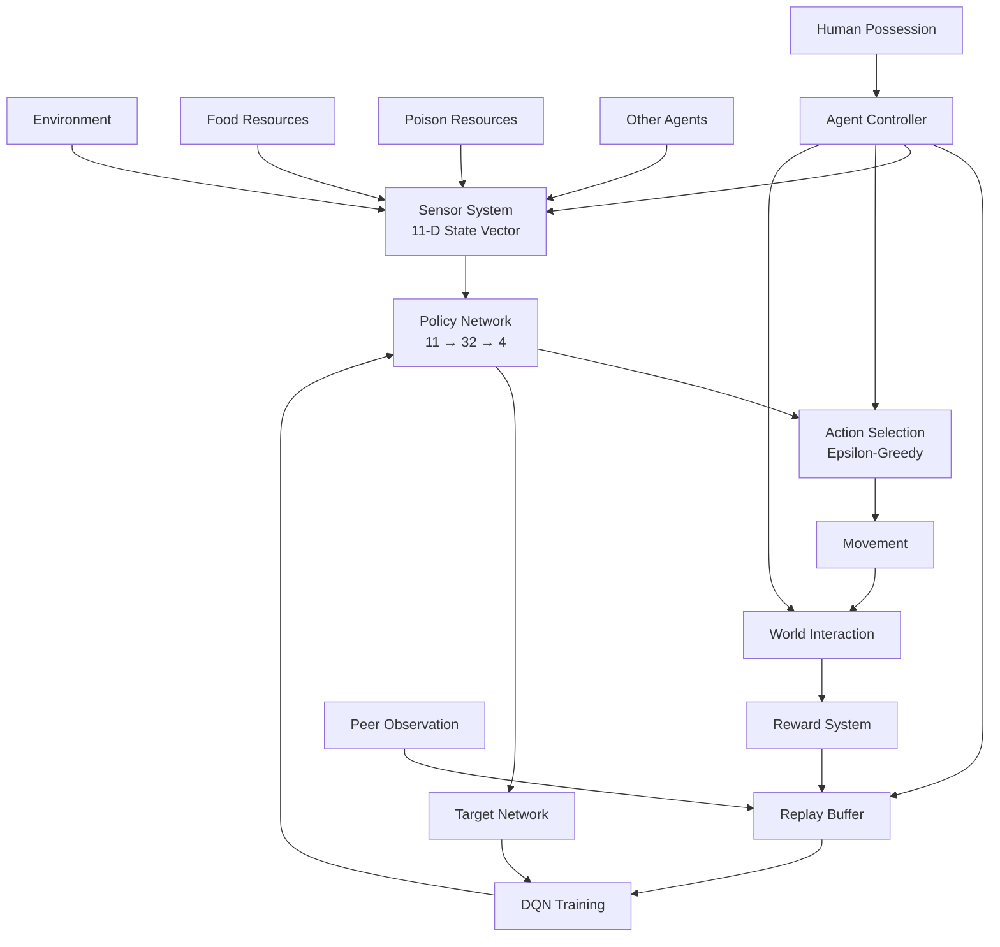
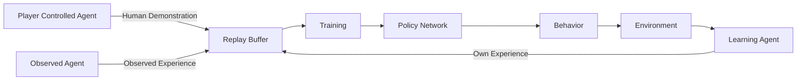
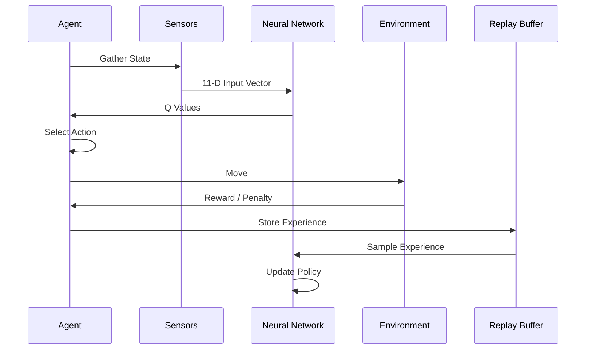

# LifeForm

An artificial life simulation built with Unity that explores reinforcement learning, social learning, predation, survival, and human-guided behavioral training.

#### Application snapshots

        Setup:        



        Arena:        



        Leaderboard:        



        Replay Arena:        



        Brain Summary:



## Overview

LifeForm is a multi-agent ecosystem where autonomous organisms learn to survive by:

- Finding food
- Avoiding poison
- Escaping stronger organisms
- Hunting weaker organisms
- Learning from direct experience
- Learning from observing peers
- Learning from human-controlled demonstrations

---

# Why LifeForm Is Different

Most AI simulations focus solely on reinforcement learning.

LifeForm combines:

```text
Reinforcement Learning
        +
Experience Replay
        +
Peer Observation
        +
Human Demonstration
        +
Predator / Prey Dynamics
        =
Emergent Intelligence
```

The result is an ecosystem where learning can spread through observation, teaching, and adaptation rather than hardcoded behavior.

---

## Download & Installation (Standalone Releases)

Due to file size constraints, standalone release packages are distributed as split 20MB archives (`.zip.001`, `.zip.002`, ... or `.z01`, `.z02`, ...). 

Ensure all archive parts for your operating system are downloaded into the **same folder** before extracting.

---

## Linux Installation (Ubuntu, Desktop Linux & Steam Deck)

1. Download all split archive parts for Linux into the same folder:
   * `LifeForm-Linux.zip.001`, `LifeForm-Linux.zip.002`, etc. (or `LifeForm-Linux.z01`, `LifeForm-Linux.zip`)

2. Open your terminal in that folder and extract using 7-Zip:
   ```bash
   7z x LifeForm-Linux.zip.001 -o~/Games/LifeForm
   ```
   *(If distributed as standard zip volumes, recombine first: `zip -s 0 LifeForm-Linux.zip --out LifeForm-Linux-Complete.zip && unzip LifeForm-Linux-Complete.zip -d ~/Games/LifeForm`)*

3. Set execution permissions and run:
   ```bash
   cd ~/Games/LifeForm/LifeForm-Linux
   chmod +x LifeForm.x86_64
   ./LifeForm.x86_64
   ```

**For Steam Deck and Steam Desktop users:**
In Desktop Mode:
1. Open the Steam Client.
2. Click **Games** > **Add a Non-Steam Game to My Library**.
3. Browse to `~/Games/LifeForm/LifeForm-Linux/LifeForm.x86_64`, add it, and return to Gaming Mode.

---

## Windows Installation

1. Download all split archive parts for Windows into the same folder:
   * `LifeForm-Windows.zip.001`, `LifeForm-Windows.zip.002`, etc. (or `.z01`, `.z02`, `.zip`)

### Option A: Using 7-Zip or WinRAR (Recommended)
1. Right-click `LifeForm-Windows.zip.001` (or `LifeForm-Windows.zip`).
2. Select **7-Zip** > **Extract to "LifeForm-Windows"** (7-Zip automatically stitches all volumes together).
3. Open the folder and double-click `LifeForm.exe`.

### Option B: Using Windows PowerShell (No third-party tools)
If using `.z01` / `.zip` split sets without 7-Zip:
```powershell
# Combine the parts into a single archive
cmd /c copy /b LifeForm-Windows.z01 + LifeForm-Windows.z02 + LifeForm-Windows.zip LifeForm-Windows-Complete.zip

# Extract the archive
Expand-Archive -Path .\LifeForm-Windows-Complete.zip -DestinationPath .\LifeForm-Windows
```
Launch by double-clicking `LifeForm.exe` inside `LifeForm-Windows`.

---

# System Architecture



---

# Learning Architecture

One of the most unique aspects of LifeForm is the combination of reinforcement learning and social learning.



This allows behavior to spread through a population without being hardcoded.

---

# Agent Decision Cycle



---

# Core Learning System

Each organism continuously performs the following loop:

```text
Observe Environment (Within Vision Arc)
        ↓
Build 11-D State Vector
        ↓
Neural Network Evaluation
        ↓
Choose Action (Epsilon-Greedy)
        ↓
Move and Interact
        ↓
Receive Reward / Penalty
        ↓
Store Experience Transition
        ↓
Sample Replay Buffer & Train Network
```

Over time, agents develop increasingly effective survival behaviors.

---

# Neural Network

Each agent contains two neural networks:
- Policy Network
- Target Network

Architecture:
```text
Input Layer      11
      ↓
Hidden Layer     32 (ReLU)
      ↓
Output Layer      4 (Linear Q-values)
```

Inputs:
- Agent normalized position ($X, Y$)
- Direction to nearest food ($X, Y$)
- Direction to nearest poison ($X, Y$)
- Direction to nearest threat ($X, Y$)
- Direction to nearest prey ($X, Y$)
- Current health ratio

Outputs:
```text
0 = Move Up
1 = Move Down
2 = Move Left
3 = Move Right
```

Action selection uses epsilon-greedy exploration.

---

# Replay Memory

Agents maintain an experience replay buffer.

Each experience contains:
```text
State
Action
Reward
Next State
Done Flag
Observation Flag
```

Experiences originate from:
1. Personal experience
2. Observed peer behavior
3. Human demonstrations

The replay buffer uses a circular overwrite strategy to maintain a fixed memory footprint.

---

# Social Learning

LifeForm supports observational learning.

When a nearby organism successfully performs an action, neighboring agents within visual range record:
```text
Observed State
Observed Action
Discounted Reward
Observed Result
```

This allows useful strategies to spread throughout the ecosystem.

---

# Human Demonstration Learning

Players can directly possess an organism and control its movement.

While possessed:
- Autonomous AI control is suspended
- Player behavior is recorded
- Nearby organisms observe player actions
- Demonstrated strategies become learning examples

Players effectively act as teachers within the ecosystem.

---

# Survival Mechanics

## Energy
Energy is the primary survival resource. Agents continuously lose energy over time to sustain movement and existence. If energy reaches zero, the agent dies, frees its colliders, and renders as a corpse.

## Food
Benefits:
```text
+30 Energy
+10 Reward
```
Food respawns dynamically based on setup toggle options.

## Poison
Risks:
```text
-40 Energy
-15 Reward
```
Agents may occasionally resist poison damage based on the configured lethal chance slider. Successful resistance is tracked independently on the leaderboard.

---

# Predation System

Agents compare energy levels with peers within visual range. When a stronger organism collides with a weaker peer, an energy siphon occurs:
- The predator drains up to 15 energy and receives positive reinforcement.
- The victim loses energy, receives negative reinforcement, and gains an escape impulse.
- The interaction triggers sword clash audio and floating combat text popups.

---

# Behavioral Profiling

When an agent dies, its behavior is classified based on lifetime performance and neural network probing:

- **Apex Predator**: Actively pursues and siphons energy from peers.
- **Forager**: Prioritizes food routes and low-risk resource gathering.
- **Cautious Survivor**: Develops high poison resistance and learned negative Q-value weights for hazards.
- **Nomadic Pacifist**: Achieves high survival longevity with minimal combat encounters.
- **Erratic Explorer / Indecisive Wanderer**: Broad arena traversal with evolving or balanced policy weights.

---

# Emergent Behaviors

LifeForm encourages the emergence of:
- Efficient foraging paths
- Poison avoidance and hazard evasion
- Predator/prey pack dynamics
- Social learning through imitation
- Human-influenced behavioral adoption
- Resource competition and territory dominance

No specific survival strategy is hardcoded.

---

# Controls

### Movement / Possession
* **Mouse Left Click**: Possess clicked agent / Deselect
* **Tab / Gamepad North (Y / Triangle)**: Cycle through living agents
* **W, A, S, D / Arrow Keys**: Move possessed agent
* **Gamepad Left Stick / D-Pad**: Move possessed agent
* **Escape**: Stop simulation and display Leaderboard

---

# Development & Source Installation

## Prerequisites

### Unity Editor
Install Unity Hub and the compatible Unity Editor version specified in:
```text
ProjectSettings/ProjectVersion.txt
```
Download Unity Hub: https://unity.com/download

---

## Clone Repository

```bash
git clone [https://github.com/bryanspms/LifeForm.git](https://github.com/bryanspms/LifeForm.git)
cd LifeForm
```

---

## Open Project in Unity

1. Launch **Unity Hub**.
2. Click **Add Project** and select the cloned `LifeForm` folder.
3. Allow Unity to import assets and compile scripts.
4. Open `Assets/LifeFormScene.unity` and click **Play** to run.

The repository excludes generated folders (`Library/`, `Temp/`, `Logs/`, `Build/`, `obj/`, and `/.plastic/`), which Unity regenerates automatically.

---

## Building Binaries

1. Go to **File** > **Build Profiles**.
2. Select **Windows** or **Linux**.
3. Click **Build** and choose your output directory.

---

## Troubleshooting

### Long Initial Load Times
On first load, Unity imports textures, compiles C# scripts, and rebuilds package caches. This can take several minutes.

### Missing Packages
Open **Window** > **Package Manager**, select **Packages: In Project**, and ensure all required dependencies are installed.

### Cache Stalls or Compiler Glitches
Try **Assets** > **Reimport All**. If issues persist, close Unity, remove the generated library cache via `rm -rf Library`, and relaunch.

---

# Project Structure

```text
Assets/
├── AgentController.cs        # Agent mechanics, DQN logic, and live sensory rays
├── AgentLifeReplayer.cs      # Timeline scrubber and replay controller
├── FloatingCombatText.cs     # World-space combat damage text popups
├── NeuralNetwork.cs          # Multi-layer perceptron (Forward & Backprop)
├── ReplayAgentGhost.cs       # Replay ghost visual rig and sensory cone rendering
├── ReplayBuffer.cs           # Circular experience buffer
├── SimulationManager.cs      # Arena coordinator, setup panel, HUD, and leaderboard
├── SpawnItem.cs              # Food and poison respawn handlers
├── Audio/                    # Siphon clashes, eat SFX, and replay music
├── LifeFormScene.unity       # Primary arena scene
└── Resources/                # Prefabs and UI materials
```

---

# Future Development

Potential future areas of exploration include:
- Genetic evolution and reproduction
- Multi-generational policy inheritance
- Flocking, schooling, and pack hunting
- Advanced multi-agent reinforcement learning algorithms
- Persistent ecosystems and exportable analytics

---

# License

LifeForm is licensed under the MIT License.

You are free to use, modify, distribute, and incorporate portions of the project for both commercial and non-commercial purposes, provided proper attribution is maintained and the original copyright notice is preserved.

See `LICENSE.txt` for details.

Copyright (c) 2026 Bryan Price

---

## Attribution

If you build upon LifeForm, attribution is appreciated:
"Based on LifeForm (github.com/bryanspms/LifeForm) by Bryan Price"